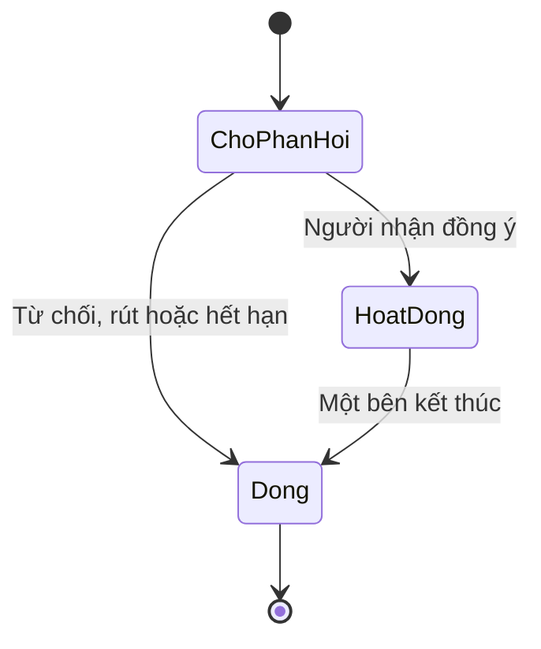

# Người, linh thú và khế ước giữa người chơi

Ngày: 13/10/2026. Nhánh game: `feat/map-ui-rebuild`.

## 1. Quyết định sản phẩm

Người chơi chọn hình dạng **người** hoặc **linh thú** khi định hình nhân vật. Linh thú do một người chơi điều khiển, có danh tính, tiến trình tu luyện, kỹ năng, đồ, bạn bè và quyền quyết định riêng. Hai người chơi có thể lập khế ước để đồng hành và phối hợp đánh quái.

Game tiếp tục phục vụ cả đời sống, giao lưu và khám phá. PvE là hoạt động chủ động. Sảnh/platform vẫn là lịch, kế hoạch, nhật ký và hoạt động tự động; hình dạng avatar không thay thế danh tính người dùng ngoài đời. Cốt truyện dài và nhiệm vụ mới phát triển sau.

## 2. Lựa chọn nhân vật

| Nội dung | Người | Mèo linh thú trong M1 |
| --- | --- | --- |
| ID hình dạng | `human / human` | `spirit_beast / cat` |
| Điều khiển | Người chơi tự di chuyển và ra đòn | Người chơi tự di chuyển và ra đòn |
| Kỹ năng đầu | Linh Trảm | Linh Trảo |
| Đòn thường | Công gốc 16 | Công gốc 16 |
| Linh thuật | Cộng 18 công, hồi 1,8 giây | Cộng 18 công, hồi 1,8 giây |
| Tiến trình | Dùng cảnh giới và XP hiện có | Dùng cùng quy tắc cảnh giới và XP |
| Túi đồ | Riêng, 24 ô | Riêng, 24 ô |
| Hoạt động đời sống | Dùng garden/activity hiện có | Dùng cùng garden/activity hiện có |

Không chia nhân vật người thành class cứng. Build tiếp tục đến từ công pháp, kỹ năng và trang bị. M1 tái sử dụng chỉ số hai slot `weapon`/`armor` cho cả hai hình dạng; bộ đồ và cách gắn vật thể riêng cho linh thú cần làm ở bước art tiếp theo. M1 không tự chuyển đổi, bán hoặc xóa trang bị cũ.

Hồ sơ cũ được bổ sung `form={kind:"human",speciesId:"human",selected:false}`; tiền, XP, đồ và các trường mở rộng được giữ. Người chơi đó vẫn được chọn lần đầu. Sau khi chọn online, hình dạng được khóa. Chơi thử offline có thể đổi qua lại để so sánh. Chọn hình dạng không phải cơ chế reset nhân vật.

## 3. Khế ước

- Mỗi nhân vật có tối đa một khế ước đang hoạt động.
- Hai bên chọn hình dạng trước khi gửi lời mời. Các cặp người–linh thú, người–người và linh thú–linh thú đều dùng cùng API; người–linh thú là cặp minh họa chính.
- Gửi bằng tên đăng nhập đã tra cứu chính xác. Người được mời phải tự xác nhận. Lời mời hết hạn sau 15 phút theo giờ máy chủ.
- Tối đa tám lời mời chờ trên mỗi tài khoản, 20 lần gửi mỗi giờ. Người bị chặn ở một trong hai chiều không thể gửi/nhận khế ước.
- Người mời được rút lời mời; người nhận được từ chối. Khi đã lập, mỗi bên được tự kết thúc khế ước.
- Kết thúc khế ước giải phóng cả hai vị trí đồng hành và giữ nguyên hồ sơ, đồ, XP của mỗi người. Phần thưởng săn đang chờ vẫn nhận được.
- Khế ước không cấp quyền điều khiển tài khoản hoặc khởi động hoạt động tự động của người kia.



## 4. Đánh quái

### Chơi riêng

Hai hình dạng dùng được `world_attack` và hệ thống mob hiện có: Sơn Trư, Độc Chu, hồi quái, XP, vật liệu, trang bị và pity. Hình dạng không yêu cầu có khế ước mới được chiến đấu. Kỹ năng khởi đầu mới được học và trang bị khi chọn hình dạng.

### Săn chung trong M1

M1 có một trận săn riêng được lưu trong khế ước. Cả hai người phải bấm **Tham gia săn chung**; người đầu tiên ở trạng thái chờ. Đây là đấu trường với vị trí trình diễn cố định và hành động RPC, chưa phải co-op di chuyển thời gian thực trên bản đồ chung.

- Một Sơn Trư có 120 HP dùng chung cho cả hai client; giáp quái 5.
- Mỗi avatar bắt đầu trận với 100 HP riêng trong đấu trường. Đây là HP của trận thử, không ghi đè HP hồ sơ ngoài thế giới.
- Công, giáp và linh thuật lấy từ hồ sơ server. Đòn thường hồi 700 ms; linh thuật hồi 1.800 ms.
- Khi hai bên ra đòn luân phiên trong vòng năm giây, đòn sau cộng bốn sát thương phối hợp.
- Quái còn sống sẽ phản đòn vào người vừa đánh, công phản đòn 8 trước giáp. Avatar đã hết HP không thể ra đòn; khi cả hai hết HP, trận thua.
- Trận tồn tại tối đa mười phút. Rời trận kết thúc trận săn hiện tại nhưng giữ khế ước. Hết giờ, hai người phải tham gia một trận mới.
- Hạ quái tăng gắn kết một điểm. Chỉ người có đóng góp sát thương nhận phần thưởng: 10 XP và một Da Sơn Trư, riêng từng tài khoản.
- Thắng tạo phần thưởng chờ. Người chơi bấm **Nhận phần thưởng săn** để đưa vào túi. Túi đầy giữ phần thưởng chờ; nhận lại không cấp trùng.
- Hai bên giải quyết phần thưởng chờ trước khi mở trận săn tiếp theo. Người thoát game không được bot tự ra đòn thay.

Gắn kết M1 là chỉ số lưu bền; chưa dùng để mở thêm kỹ năng, cảnh giới hoặc tăng sức mạnh ngoài đòn phối hợp. Các giá trị này là mốc prototype để kiểm tra vòng chơi, chưa phải cân bằng economy cuối cùng.

## 5. Sảnh và hoạt động tự động

`form` nằm trong cùng hồ sơ nhân vật nên sảnh có thể dùng hình dạng đó cho avatar. Khế ước và thưởng chờ được truy vấn qua RPC dùng chung tài khoản. Phần này chưa sửa code nhánh platform.

Mỗi người chọn lịch và activity riêng. Trồng cây/câu cá/đào khoáng vẫn hoạt động theo backend đời sống hiện có. Khi nhân vật đang có activity chưa kết thúc, chọn hình dạng hoặc ra đòn săn chung bị từ chối. Có kiểm tra lại phiên bản hồ sơ khi ghi trận săn để tránh activity khởi động đồng thời với hành động săn.

Hiện diện bạn đồng hành trong thế giới map và avatar tự đi khi chủ tài khoản đóng game vẫn thuộc pipeline presence/activity trước đó. Khế ước M1 không tạo một bản sao avatar để cày thưởng.

## 6. Phần đã có code

| Thành phần | Đã triển khai |
| --- | --- |
| Chọn nhân vật | Người và mèo, kỹ năng đầu, chọn một lần online, bổ sung hồ sơ cũ |
| Khế ước | Gửi/đồng ý/từ chối/rút/hủy, giới hạn một cặp, kiểm tra chặn, lưu bền |
| Săn chung | Hai người tự tham gia, HP quái chung, phản đòn, đòn phối hợp, rời/hết giờ |
| Thưởng | Đóng góp riêng, thưởng chờ, claim chống trùng, giữ khi túi đầy/hủy khế ước |
| Client F5 | Cảnh chơi thử, sprite pixel vẽ bằng code, điều khiển PC và nút chạm |
| Online | Đăng ký/đăng nhập email hoặc tên đăng nhập; UI khế ước, săn và claim |
| Map trực tiếp | Client đọc geometry server và dùng world_move/world_attack/world_interact |

Asset nhân vật/quái/map trong cảnh mới là placeholder vẽ bằng code. Cảnh này phục vụ kiểm tra gameplay và API; chưa khôi phục bản art làng đã bị gỡ khỏi checkout trước đó. Cảnh M1 mới dùng tiếng Việt; giao diện Việt–Anh đầy đủ cần nối vào bộ localization ở milestone tiếp theo.

## 7. Lộ trình mở rộng

1. Hoàn thiện animation idle/walk/run/attack/hit của người và mèo theo Art Bible, vị trí đồ, hitbox và camera PC/mobile.
2. Nối chọn hình dạng và bạn khế ước vào UI nhân vật, hồ sơ và presence của map chính khi runtime map được đưa trở lại.
3. Chuyển trận săn thử sang Nakama authoritative match: cùng map, đồng bộ vị trí/AI, né và cứu đồng đội, đóng góp theo encounter.
4. Thêm chó/cáo sau khi một loài được nghiệm thu. Giữ khả năng chơi riêng và bộ tiến trình chung; phát triển khác biệt bằng bộ kỹ năng.
5. Nối avatar/khế ước vào sảnh platform và kiểm tra activity/presence qua hai client.
6. Thiết kế mở kỹ năng theo gắn kết, tiến hóa hoặc hóa hình sau; không kéo cốt truyện/quest mới vào M1.

## 8. Chạy và nghiệm thu

Mở `client/project.godot` bằng Godot 4.6.1 rồi bấm F5. Chọn người/mèo; di chuyển bằng WASD hoặc mũi tên, Space đánh thường, R linh thuật, E tương tác. Có nút chạm dưới khung game. Thưởng thử không lưu vào tài khoản.

Để chơi có lưu:

```sh
docker compose up --build --wait --wait-timeout 180
node scripts/spirit-contract-smoke.mjs
```

Mở hai cửa sổ game, tạo/đăng nhập hai tài khoản riêng, chọn hình dạng. A nhập username của B và gửi lời mời; B đồng ý. Hai bên bấm tham gia săn, ra đòn luân phiên, rồi mỗi người nhận thưởng. Thử kết thúc khế ước và đăng nhập lại: hình dạng và tiến trình vẫn còn.

Kiểm tra tự động:

```sh
cd server
npm ci
npm test
cd ..
godot --headless --path client --editor --quit
godot --headless --path client --script res://tests/spirit_gameplay_smoke.gd
godot --headless --path client --script res://tests/spirit_api_live_smoke.gd
```

Smoke offline kiểm tra chọn hai hình dạng, va chạm, hạ quái và UI. Smoke live cần backend đang chạy, kiểm tra adapter Godot bằng tài khoản thử riêng. API chi tiết: [Khế ước và PvE chung](../spirit-contracts-backend.md).

Kiểm chứng khi bàn giao M1: 144 unit test backend đạt; Godot 4.6.1 import/chạy scene và smoke offline đạt; đã render để kiểm tra bố cục PC 1280×720 và màn hình hẹp 720×1000. Adapter Godot đã đi hết luồng đăng ký, chọn hình dạng, lập khế ước, hai người săn, nhận thưởng và kết thúc qua HTTP với runtime TypeScript cùng storage giả lập cục bộ. Smoke trên Nakama/PostgreSQL thật đã được thêm vào CI, chưa chạy ở môi trường bàn giao này.
